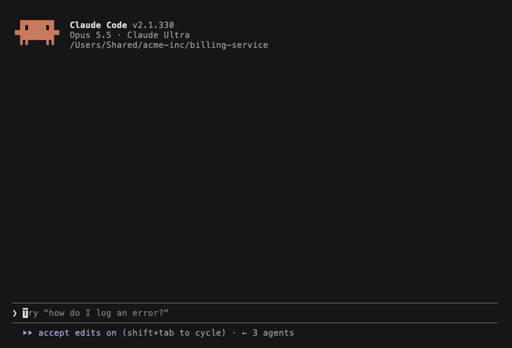

# solo-agent-guards

[English](README.md) · 한국어

코딩 에이전트가 끝나지 않은 일을 「다 됐다」고 말하지 못하게 막는 에이전트 스킬입니다. 뒤에서 검토해 줄 사람 없이 AI 코딩 에이전트를 혼자 쓰는 사람을 위해 만들었습니다.



<sub>이 플러그인을 켠 Claude Code에서 작은 예시 프로젝트로 녹화했습니다. 기다리는 시간은 자르고 오래 도는 구간은 빠르게 돌렸습니다.</sub>

- **[`test-and-prove`](skills/test-and-prove/SKILL.md): 테스트가 통과했다고 아직 증명된 것은 없습니다.** 에이전트는 테스트가 지키는 가드를 빼고, 그 테스트만 돌려 실패하는지 보고, 가드를 되돌립니다. 그래도 초록이면 그 테스트는 아무것도 지키지 않으므로 다시 씁니다. 에이전트는 exit code가 아니라 실행 건수를 읽습니다. `go test -run X`와 `jest -t X`는 아무것도 돌지 않아도 0으로 끝나기 때문입니다.
- **[`change-integrity`](skills/change-integrity/SKILL.md): push가 성공했다고 아직 증명된 것은 없습니다.** 에이전트는 원격 SHA, 기준 브랜치와의 세 점 diff, PR·MR에 실제로 담긴 변경을 확인합니다. 자기가 바꾼 경로만 스테이징하고, 다른 세션의 미완성 작업은 건드리지 않습니다.
- **[`claim-audit`](skills/claim-audit/SKILL.md): 성공 문구가 떴다고 아직 증명된 것은 없습니다.** 에이전트는 「머지됐다」「배포됐다」「통과」「운영에서 돈다」나 실적 숫자를 보고하기 전에 대상을 다시 읽고 네 틈을 막습니다. 예약만 된 머지, 한 번도 실패해 본 적 없는 검사, 자기 시험 접속이 섞인 숫자, 운영 상태로 둔갑한 수동 실행입니다. 남이 만든 일을 이어받기 전에는 카드 상태가 아니라 검수자의 마지막 판정을 읽습니다.
- **[`done-checklist`](skills/done-checklist/SKILL.md): 「다 됐다」는 끝 조건과 점검표를 기다립니다.** 에이전트는 시작 전에 끝 조건을 확인 방법과 함께 적습니다. 「확인했어?」「또 빠졌네」처럼 지적받을 때마다 저장소의 점검표에 그 실수의 종류를 한 줄 더합니다. 「다 됐다」고 하기 전에 둘을 모두 돌려 통과·실패 표로 보고합니다.
- **[`decision-ledger`](skills/decision-ledger/SKILL.md): 대화에서 정한 것은 대화창과 함께 사라집니다.** 프로젝트에 대해 무언가를 정하거나 뒤집으면(「앞으로는…」, 「그건 빼」) 에이전트는 날짜, 원문, 범위를 `DECISIONS.md`에 적고, 옛 결정에 기대던 곳을 표시합니다. 일을 시작하거나 이어받기 전에는 요약이 아니라 장부와 원문 기획서를 읽습니다. 개인 취향은 그대로 에이전트 메모리에 두고, 프로젝트 결정은 동료와 다음 세션이 읽는 곳에 둡니다.

## 이렇게 보고합니다

`test-and-prove`를 쓰면 에이전트는 초록 결과만이 아니라 가드를 부순 결과를 보고합니다. 위 녹화에서 나온 보고입니다(원문은 영어).

> | `billing/refunds.py`에서 바꾼 것 | 돌린 테스트 | 결과 |
> |---|---|---|
> | `if order.refunded:` → `if False:` | `test_refund_rejects_already_refunded_order` | 1 failed |
> | `if amount > order.total:` → `if False:` | `test_refund_rejects_amount_over_total_and_leaves_order_untouched` | 1 failed |
> | `>` → `>=` (전액 환불을 막는 경계값 실수) | `test_refund_marks_order_refunded` | 1 failed |
>
> 실행마다 실패가 1건씩 나왔습니다. 그러니 테스트가 건너뛰어진 것이 아니라 실제로 골라져서 실패했습니다. 코드를 되돌린 뒤 `git diff billing/`은 비어 있고 전체 스위트가 다시 통과합니다(4 passed).

`change-integrity`를 쓰면 올리려던 것이 아니라 실제로 올라간 것을 읽습니다.

> push는 성공했지만 `git diff --stat origin/main...origin/fix-refund`에 파일이 3개 보이고, 제가 바꾼 것은 2개입니다. `config/billing.yml`은 다른 세션의 미완성 작업입니다. `origin/main`에서 제 커밋만으로 브랜치를 다시 만들어 `fix-refund-2`로 push했습니다. 새 PR에는 파일 2개만 보입니다.

`claim-audit`를 쓰면 도구가 찍은 문구가 아니라 증거가 닿은 만큼만 보고합니다.

> MR !42는 아직 머지되지 않았습니다. `glab mr merge`는 "Merged!"를 찍었지만 API는 `state: opened`, `merge_when_pipeline_succeeds: true`, `merge_commit_sha: null`입니다. CI가 통과하면 머지되도록 예약만 걸린 상태입니다. 인용 검사는 3/3 통과라고 하지만, 아무것도 인용하지 않은 영수증도 통과시킵니다. 검사가 고장 났습니다. 손으로 고쳐 다시 세면 2/3입니다. 어제 결제 7건 중 4건은 curl·python-requests에서 온 mock 결제이고 1건은 내부 QA 계정이라, 고객으로 보이는 것은 2건입니다.

<sub>`test-and-prove` 보고는 녹화에서 옮겼습니다. `change-integrity` 보고는 이름을 지어낸 예시입니다. `claim-audit` 보고는 함정을 심은 작은 예시 프로젝트에서 시험한 결과를 줄였습니다.</sub>

## 설치

Claude Code:

```
/plugin marketplace add robfold/solo-agent-guards
/plugin install solo-agent-guards@solo-agent-guards
```

다른 에이전트는 [skills CLI](https://skills.sh)로 설치합니다.

```
npx skills add robfold/solo-agent-guards
```

또는 [`skills/`](skills/) 안의 폴더를 에이전트의 스킬 폴더에 복사합니다. Claude Code는 `~/.claude/skills/`입니다.

## 쓰는 법

요청이 맞으면 스킬이 알아서 켜집니다. `test-and-prove`는 테스트·커버리지·플레이크 수정을 요청할 때 켜집니다. `change-integrity`는 커밋·push·PR·MR을 요청할 때 켜집니다. `claim-audit`는 에이전트가 상태나 실적 숫자를 보고하기 직전, 그리고 「진짜야?」라고 물을 때 켜집니다. `done-checklist`는 일을 맡기며 끝 조건을 요청할 때, 「확인했어?」라고 묻거나 빠진 것을 짚을 때, 그리고 에이전트가 「다 됐다」고 보고하기 직전에 켜집니다. `decision-ledger`는 프로젝트에 대해 무언가를 정하거나 뒤집을 때, 「지난번에 정했잖아」라고 할 때, 기획서나 이슈로 일을 이어받기 직전에 켜집니다. 이름으로 부를 수도 있습니다. 예: "환불 검사 테스트를 짜고 증명까지 해".

`test-and-prove`는 실행기가 찍은 숫자 그대로와, 새 테스트마다 가드를 부순 결과로 끝납니다. `change-integrity`는 원격 SHA와 PR·MR에 실제로 담긴 diff로 끝납니다. `claim-audit`는 주장마다 어디서 다시 읽었는지, 또는 읽지 못했는지를 붙여 끝납니다. `done-checklist`는 끝 조건과 점검표 항목마다 통과·실패·못 봄과 그 증거를 적은 표로 끝납니다. `decision-ledger`는 새로 적은 장부 항목이나, 이번 일에 걸리는 결정 목록(「걸리는 결정 0건」 포함)으로 끝납니다.

## 다른 스킬이 맞을 때

- **코드베이스 전체의 변이 테스트:** [Stryker](https://stryker-mutator.io/), [mutmut](https://github.com/boxed/mutmut), [PIT](https://pitest.org/)를 쓰세요. `test-and-prove`는 같은 일을 방금 쓴 테스트 하나에 손으로 합니다.
- **테스트를 먼저 쓰기:** obra의 superpowers에 있는 [`test-driven-development`](https://github.com/obra/superpowers/tree/main/skills/test-driven-development)를 쓰세요. TDD는 코드가 생기기 전에 테스트가 실패하는 것을 봅니다. `test-and-prove`는 코드가 생긴 뒤에 가드를 부숩니다. 그래서 오래된 코드에 붙이는 테스트에도 쓸 수 있습니다.
- **성공이라고 말하기 전에 증거부터:** obra의 superpowers에 있는 [`verification-before-completion`](https://github.com/obra/superpowers/tree/main/skills/verification-before-completion)이 이 원칙을 넓게 다룹니다. 이 세 스킬은 그 말이 가장 자주 틀리는 곳, 테스트와 push와 잘못된 종류의 증거에 기댄 상태 보고를 더 깊게 다룹니다.
- **격리된 작업 공간 만들기:** obra의 superpowers에 있는 [`using-git-worktrees`](https://github.com/obra/superpowers/tree/main/skills/using-git-worktrees)를 쓰세요. `change-integrity`도 worktree를 쓰지만, 할 일은 실제로 무엇이 올라갔는지 확인하는 것입니다.

## 출처

규칙은 이 스킬의 첫 사용자가 에이전트에게 준 교정에서 나왔습니다. `test-and-prove`의 생각은 변이 테스트입니다. `change-integrity`는 명령 근거로 git 공식 문서를 링크합니다. `claim-audit`의 틈은 하나하나가 실제 사고에서 나왔습니다.

## 라이선스

[MIT](LICENSE)
