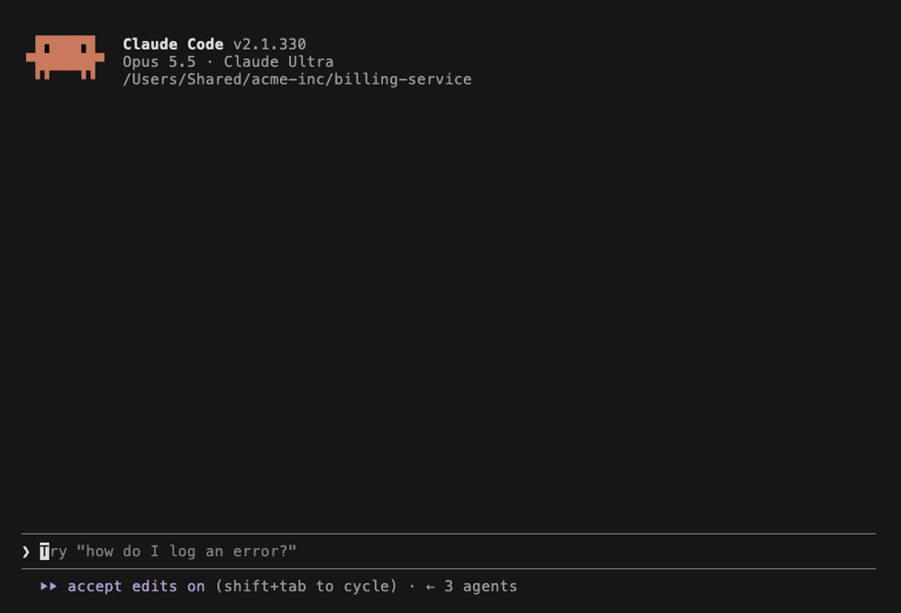

# solo-agent-guards

English · [한국어](README.ko.md)

Agent skills that stop a coding agent from saying "done" when it isn't. For people who run an AI coding agent alone, with no reviewer behind it.



<sub>Recorded in Claude Code with this plugin loaded, on a small example project. Idle time is cut and long busy stretches are sped up.</sub>

- **[`test-and-prove`](skills/test-and-prove/SKILL.md): a passing test proves nothing yet.** The agent removes the guard the test protects, runs only that test, sees it fail, and restores the guard. A test that stays green guards nothing and gets rewritten. The agent reads the run count, not the exit code: `go test -run X` and `jest -t X` exit with 0 when nothing ran.
- **[`change-integrity`](skills/change-integrity/SKILL.md): a successful push proves nothing yet.** The agent checks the remote SHA, the three-dot diff from the base, and what the PR or MR really contains. It stages only its own paths and leaves other sessions' unfinished work alone.
- **[`claim-audit`](skills/claim-audit/SKILL.md): a success message proves nothing yet.** Before the agent reports "merged", "deployed", "passed", "running in production", or a result number, it re-reads the target and closes four gaps: a merge that is only scheduled, a check that has never failed, a number padded with its own test traffic, and a manual run reported as production. Before it takes over someone else's work, it reads the reviewer's last verdict, not the card's status.
- **[`done-checklist`](skills/done-checklist/SKILL.md): "done" waits for a finish line and a checklist.** The agent writes the finish line before it starts, each condition with its check. Every time you correct it ("did you check?", "you missed it again"), it adds one line, for the kind of miss, to the repository's checklist. Before it says "done", it runs both and reports a pass/fail table.
- **[`decision-ledger`](skills/decision-ledger/SKILL.md): a decision made in chat dies with the chat.** When you decide or reverse something about the project ("from now on…", "drop that"), the agent writes it to `DECISIONS.md` with the date, your exact words, and its scope, and marks what the old decision affected. Before it starts or resumes work, it reads the ledger and the original spec, not a summary. Your personal preferences still go to the agent's memory; project decisions go where teammates and the next session can read them.

## What it looks like

With `test-and-prove`, the agent reports the break, not just the green run. This is the report from the recording above:

> | Change to `billing/refunds.py` | Test run | Result |
> |---|---|---|
> | `if order.refunded:` → `if False:` | `test_refund_rejects_already_refunded_order` | 1 failed |
> | `if amount > order.total:` → `if False:` | `test_refund_rejects_amount_over_total_and_leaves_order_untouched` | 1 failed |
> | `>` → `>=` (an off-by-one that blocks a full refund) | `test_refund_marks_order_refunded` | 1 failed |
>
> Each run reported 1 test failing, so the test was selected and failed, not skipped. After putting the code back, `git diff billing/` is empty and the suite passes again (4 passed).

With `change-integrity`, it reads what landed, not what it meant to push:

> The push succeeded, but `git diff --stat origin/main...origin/fix-refund` shows 3 files and I changed 2. `config/billing.yml` is another session's unfinished work. I rebuilt the branch from `origin/main` with only my commit and pushed `fix-refund-2`. The new PR shows 2 files.

With `claim-audit`, it reports what the evidence reaches, not what the tool printed:

> MR !42 is not merged yet. `glab mr merge` printed "Merged!", but the API says `state: opened`, `merge_when_pipeline_succeeds: true`, `merge_commit_sha: null`: the merge is scheduled for when CI passes. The quote check says 3/3 passed, but it also passes a receipt that quotes nothing, so the check is broken; fixed by hand, the result is 2/3. Yesterday shows 7 paid orders; 4 are mock payments from curl and python-requests and 1 is an internal QA account, so 2 look like customers.

<sub>The `test-and-prove` report is copied from the recording. The `change-integrity` report is an example with made-up names. The `claim-audit` report is shortened from a test run on a small example project with planted traps.</sub>

## Install

Claude Code:

```
/plugin marketplace add robfold/solo-agent-guards
/plugin install solo-agent-guards@solo-agent-guards
```

Other agents, with the [skills CLI](https://skills.sh):

```
npx skills add robfold/solo-agent-guards
```

Or copy the folders in [`skills/`](skills/) into your agent's skills folder (`~/.claude/skills/` for Claude Code).

## Use

The skills load on their own when the request matches. `test-and-prove` loads when you ask for tests, coverage, or a flaky-test fix. `change-integrity` loads when you ask the agent to commit, push, or open a PR or MR. `claim-audit` loads right before the agent reports a status or a result number, and when you ask "is that real?". `done-checklist` loads when you hand over work and ask for a finish line, when you ask "did you check?" or point out a miss, and right before the agent reports "done". `decision-ledger` loads when you decide or reverse something about the project, when you say "we already decided this", and before the agent resumes work from a spec or issue. You can also call any of them by name: "write tests for the refund check and prove them".

`test-and-prove` ends with numbers as the runner printed them, plus the mutation result for each new test. `change-integrity` ends with the remote SHA and the diff the PR or MR really contains. `claim-audit` ends with each claim next to the evidence it was re-read from, or a note that it could not be. `done-checklist` ends with a table of every finish-line condition and checklist line, with pass, fail, or not checked, and its evidence. `decision-ledger` ends with the ledger entry it wrote, or the list of decisions that apply to the task ("0 decisions apply" included).

## When to use something else

- **Mutation testing across a whole codebase:** [Stryker](https://stryker-mutator.io/), [mutmut](https://github.com/boxed/mutmut), or [PIT](https://pitest.org/). `test-and-prove` does the same thing by hand, for the one test you just wrote.
- **Writing the test first:** [`test-driven-development`](https://github.com/obra/superpowers/tree/main/skills/test-driven-development) in obra's superpowers. TDD watches the test fail before the code exists. `test-and-prove` breaks the guard after the code exists, so it also works for tests you add to old code.
- **Evidence before any claim of success:** [`verification-before-completion`](https://github.com/obra/superpowers/tree/main/skills/verification-before-completion) in obra's superpowers covers this in general. These three skills go deeper on the places where that claim most often goes wrong: tests, pushes, and status reports built on the wrong kind of evidence.
- **Setting up an isolated workspace:** [`using-git-worktrees`](https://github.com/obra/superpowers/tree/main/skills/using-git-worktrees) in obra's superpowers. `change-integrity` also uses worktrees, but its job is to check what actually went up.

## Credits

The rules came from corrections by the person these skills were first built for. The idea in `test-and-prove` is mutation testing. The command evidence in `change-integrity` links to the git documentation it relies on. Each gap in `claim-audit` comes from a real incident.

## License

[MIT](LICENSE)
